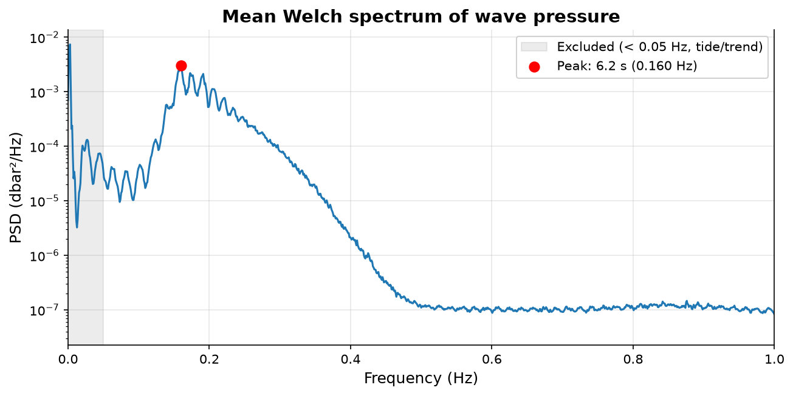
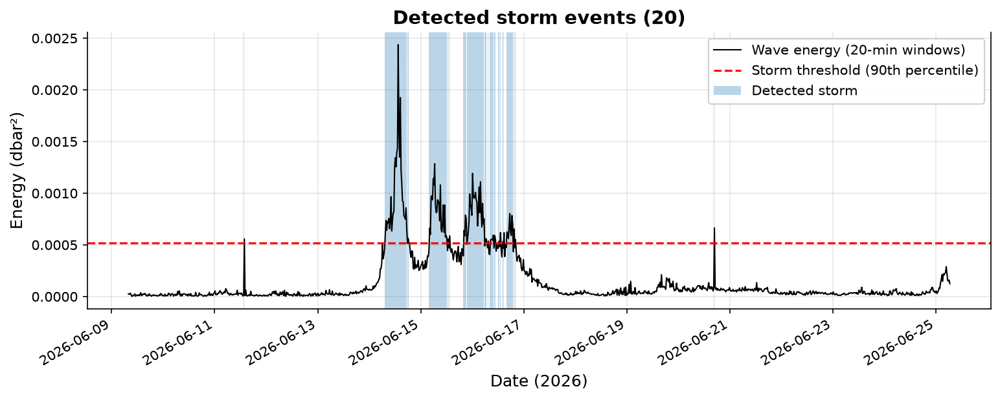
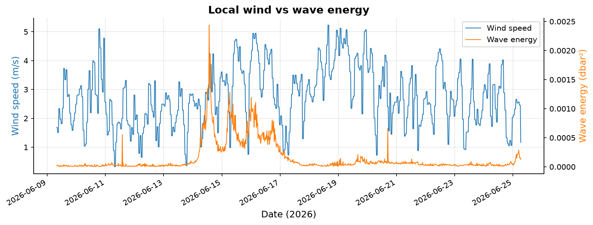

# Wave Analysis

🇷🇺 [Русская версия](README.ru.md)

A Python pipeline for processing data from **RBR** bottom pressure loggers (`.rsk` files) and analysing sea waves: from raw pressure and temperature records to wave spectra, storm detection and comparison with local wind.

Put your `.rsk` file in, and the program builds the figures, tables and reports by itself.

I wrote it during my field practice as an oceanology student at Lomonosov Moscow State University, to process our own measurements of coastal waves.

## Example results

The figures below come from a 16-day record (June 2026) of an RBRduo³ logger installed at about 6 m depth in Golubaya Bay, Black Sea, sampling at 4 Hz (≈5.5 million measurements).

**Wave spectrum.** The mean spectrum shows a clear peak at a period of about 6.2 s. Frequencies below 0.05 Hz (tide and slow trend) are excluded before searching for the wave peak.



**Storm detection.** Wave energy is computed in 20-minute windows. Windows above the 90th percentile are marked as storms. The program found 20 storm events, and the longest lasted about 10 hours.



**Wind and waves.** The correlation between local wind speed and wave energy is weak (Pearson r ≈ 0.20). The wave-age analysis (c_p / U10) classifies almost all windows as swell, so the waves at this site were mostly generated far away and not by the local wind.



## Pipeline steps

1. **Reading** the `.rsk` file (`RBRReader`)
2. **Quality control** of the raw data (`QualityControl`)
3. **Preprocessing**: pressure and depth (`DataPreparation`)
4. **Gap detection** in the time series (`GapDetector`)
5. **Segmentation** of the record at gaps (`Segmenter`)
6. **Cleaning** of the segments (`DataCleaner`)
7. **Wave preprocessing**: slow trend removal, wave pressure (`WavePreprocessor`)
8. **Wave overview** (`WaveAnalysis`)
9. **Spectral analysis** of waves, Welch method (`WaveSpectra`)
10. **Storm detection and analysis** (`StormAnalysis`)
11. **Wind–wave comparison** and wave age (`WindWaveAnalysis`)
12. **Temperature analysis** (`TemperatureAnalysis`)
13. **Instrument information** (`RSKInspector`)
14. **Summary statistics** for the whole project (`SummaryStatistics`)

## Installation

```bash
python -m venv .venv
source .venv/bin/activate
pip install -r requirements.txt
```

## Usage

1. Put your `.rsk` file in `data/raw/`.
2. Optionally, put a CSV with wind data in `data/wind/wind.csv`.
3. Set the file paths in `main.py`.
4. Run:

```bash
python main.py
```

The results (figures, tables, reports) will appear in the `output/` folder.

## Project structure

```
main.py                 — entry point, runs the whole pipeline
src/                    — processing and analysis modules
data/
  raw/                  — source .rsk files (not published)
  processed/            — intermediate CSV files
  wind/                 — wind data
output/
  figures/              — figures
  tables/               — tables (CSV)
  reports/              — reports
  logs/                 — logs
docs/figures/           — example figures for this README
```

## Requirements

Python 3, with numpy, pandas, matplotlib, scipy, tqdm and pyrsktools (see `requirements.txt`).

## Author

Mikhail Lyubimov, oceanology student, Faculty of Geography, Lomonosov Moscow State University.
